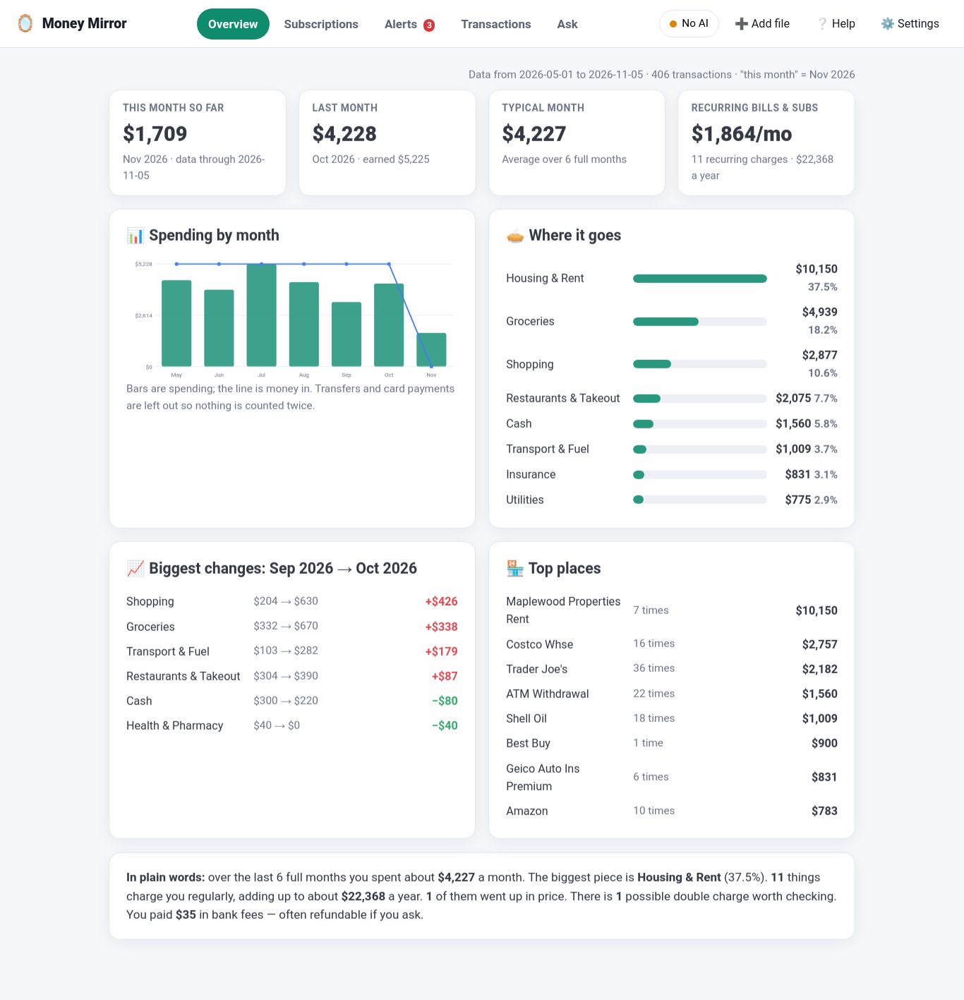
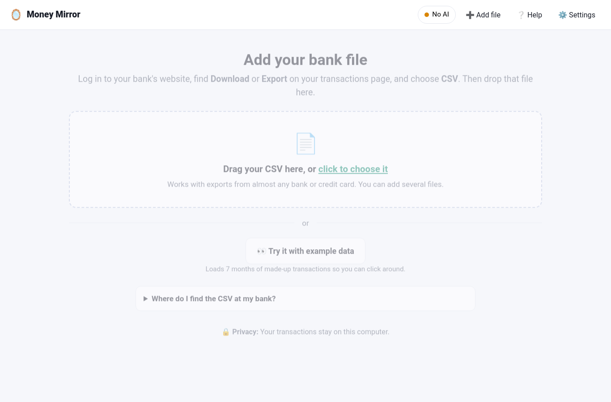

# 🪞 Money Mirror

**See where your money really goes — from the CSV your bank already lets you download. No bank login. Nothing uploaded. Runs on your own computer.**

Drop in a bank or credit-card export and Money Mirror shows you:

- **Subscriptions and bills** that charge you on a rhythm — and which ones **went up in price**
- **Possible double charges**, bank fees, and unusually big purchases
- **What you spend each month**, by category and by place, and how it's changing
- **Plain-English answers**: *"How much did I spend on eating out since March?"*



> **Private by design.** Your file is read on this computer and kept in a small database in your home folder. The optional AI never sees amounts or dates — only merchant names and your typed questions. It works fully without any AI.

---

## Install (3 steps, about 2 minutes)

Works on Ubuntu, Debian, and most Linux. You need Python 3.10 or newer (most Linux already has it).

**1. Get the code**

```bash
git clone https://github.com/Sockshare/money-mirror.git
cd money-mirror
```

**2. Set up Python (one time)**

```bash
python3 -m venv .venv
source .venv/bin/activate
pip install -r requirements.txt
```

> If `python3 -m venv` complains about *ensurepip*, run `sudo apt install python3-venv` and try again.
> No admin rights? Use this instead of the first line: `python3 -m venv --without-pip .venv && . .venv/bin/activate && curl -sS https://bootstrap.pypa.io/get-pip.py | python`

**3. Start it**

```bash
python app.py
```

Your browser opens to `http://127.0.0.1:8766`. Click **Try it with example data** to look around before using your own file.

Next time, just run `source .venv/bin/activate` and `python app.py`.

---

## Getting your bank file

1. Log in to your bank's **website** (apps often can't export).
2. Open the account → **Transactions** or **Activity**.
3. Look for **Download**, **Export**, or a ⬇️ icon. Choose **CSV** (sometimes called "Excel" or "Spreadsheet").
4. Pick the longest date range they allow — 12 months or more gives the best picture.
5. Drop the file into Money Mirror. Add your credit cards too. Adding the same file twice is safe; nothing is counted twice.

Money Mirror reads exports from almost any bank. It figures out the columns on its own (dates in any format, separate Debit/Credit columns, European decimals, extra header lines).



---

## Do I need AI?

No. Everything works with built-in rules. AI is optional and only used for two small things:

| | Without AI (default) | With AI |
|---|---|---|
| Categorizing places | 300+ built-in rules cover most merchants; you fix the rest with one click and it remembers | Also names unusual merchants for you |
| Asking questions | Understands common phrasings (see the example chips) | Understands trickier wording |
| What the AI sees | — | Merchant **names** and your **question text** only. Never amounts, dates, or your file. |

If you want AI, the free private option is [Ollama](https://ollama.com): `curl -fsSL https://ollama.com/install.sh | sh` then `ollama pull llama3.2:3b`, and pick **AI on my computer** in Settings.

---

## The tabs

- **Overview** — this month, last month, a typical month, recurring charges, spending by month, where it goes, biggest changes, top places, and a plain-words summary.
- **Subscriptions** — everything that charges you on a rhythm, with cost per year, price increases, and ones that stopped.
- **Alerts** — double charges, price increases, fees, big one-offs. Click one to see the transactions.
- **Transactions** — search everything; change a category and the app remembers it for that place.
- **Ask** — type a question in plain English. Click "Show the transactions behind this answer" to check the math. If it doesn't understand, it says so.

Full tour with pictures: [docs/USER_GUIDE.md](docs/USER_GUIDE.md)

---

## Something not working?

```bash
python scripts/selfcheck.py
```

Then see [docs/TROUBLESHOOTING.md](docs/TROUBLESHOOTING.md).

## More

- [User Guide](docs/USER_GUIDE.md) · [FAQ](docs/FAQ.md) · [Privacy](docs/PRIVACY.md) · [Troubleshooting](docs/TROUBLESHOOTING.md) · [Architecture](docs/ARCHITECTURE.md) · [Quality report](QUALITY.md)

## Important

Money Mirror is a helper for understanding your own spending. It is not financial advice, and it can mis-categorize things — check before acting on a number. It never moves money or connects to your bank.

## License

MIT — free to use, share, and change. See [LICENSE](LICENSE).
