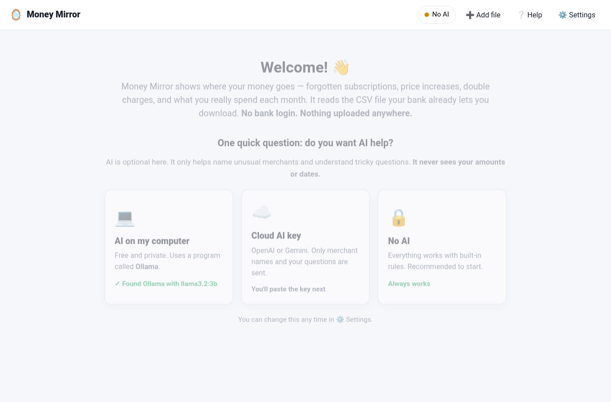
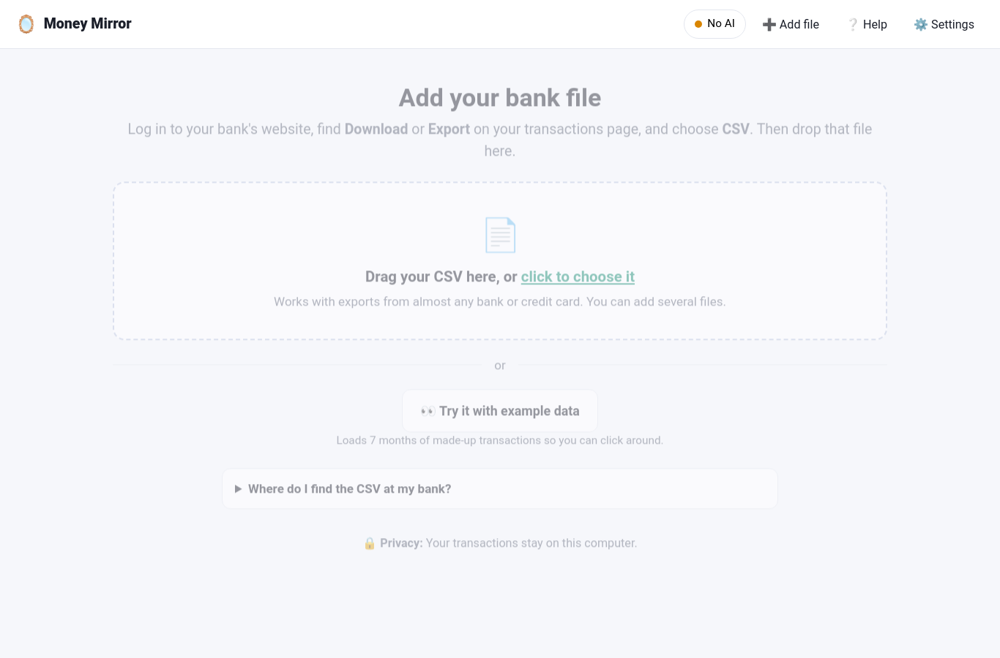
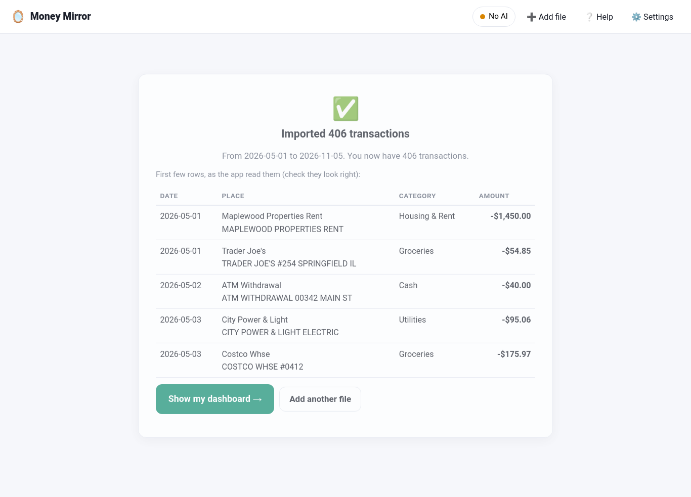
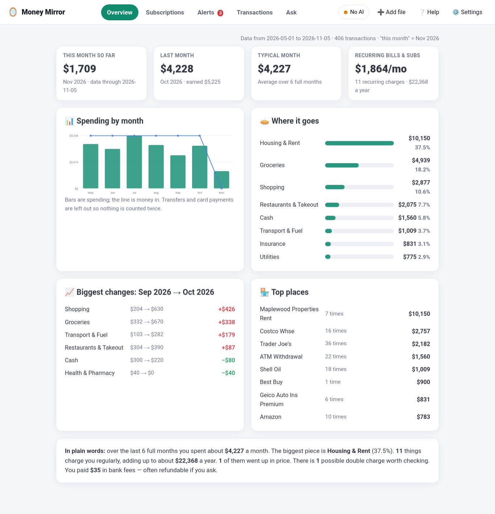
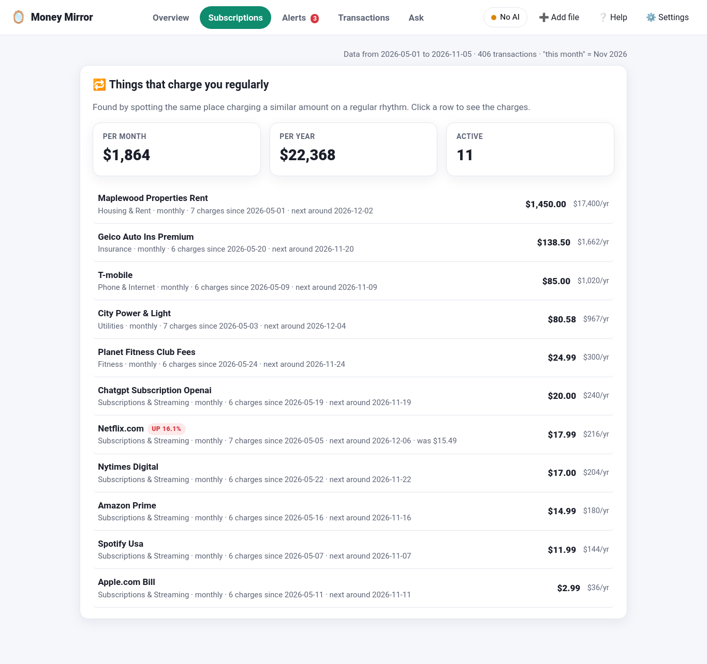
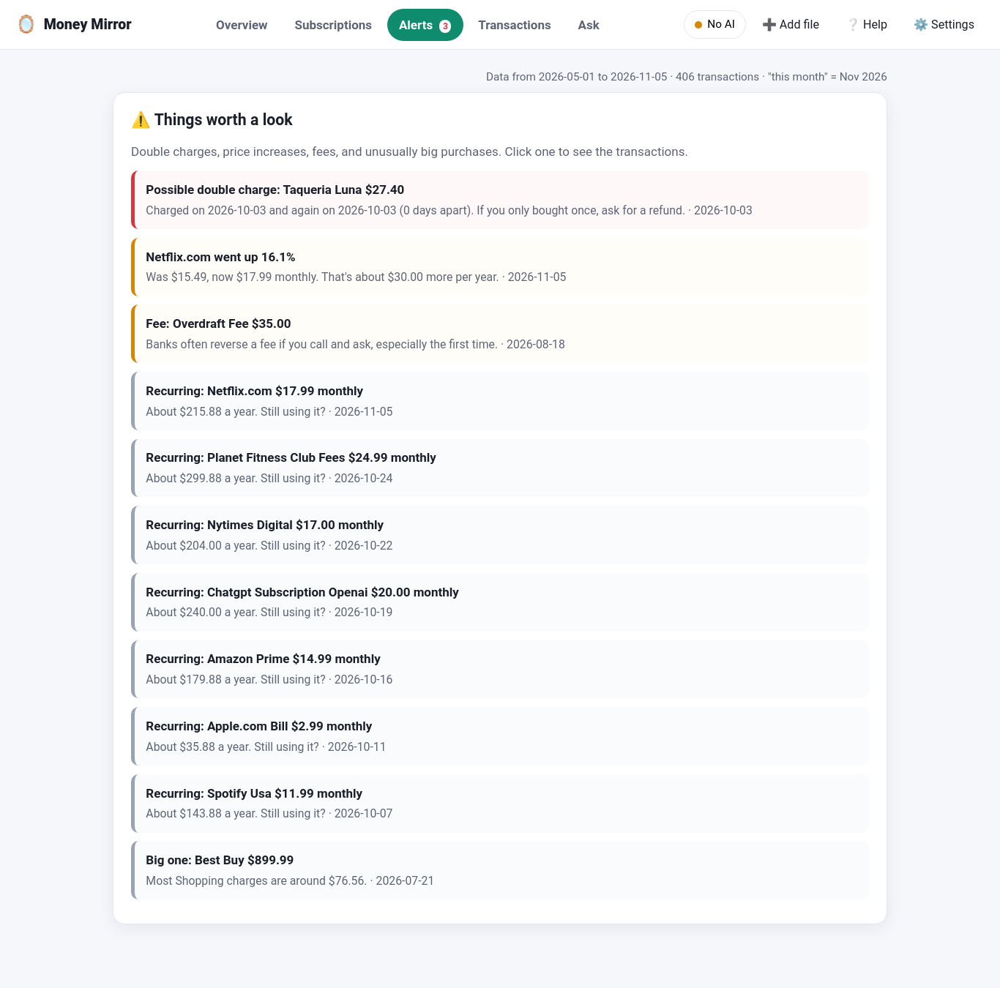
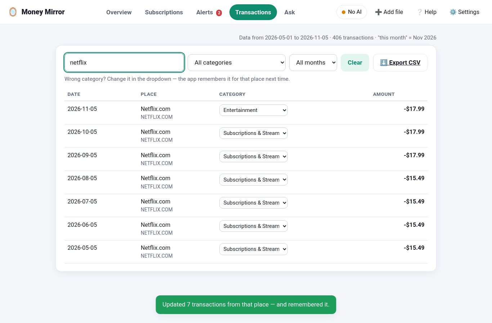
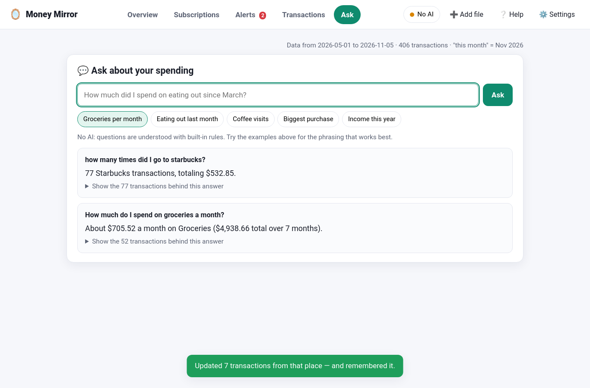
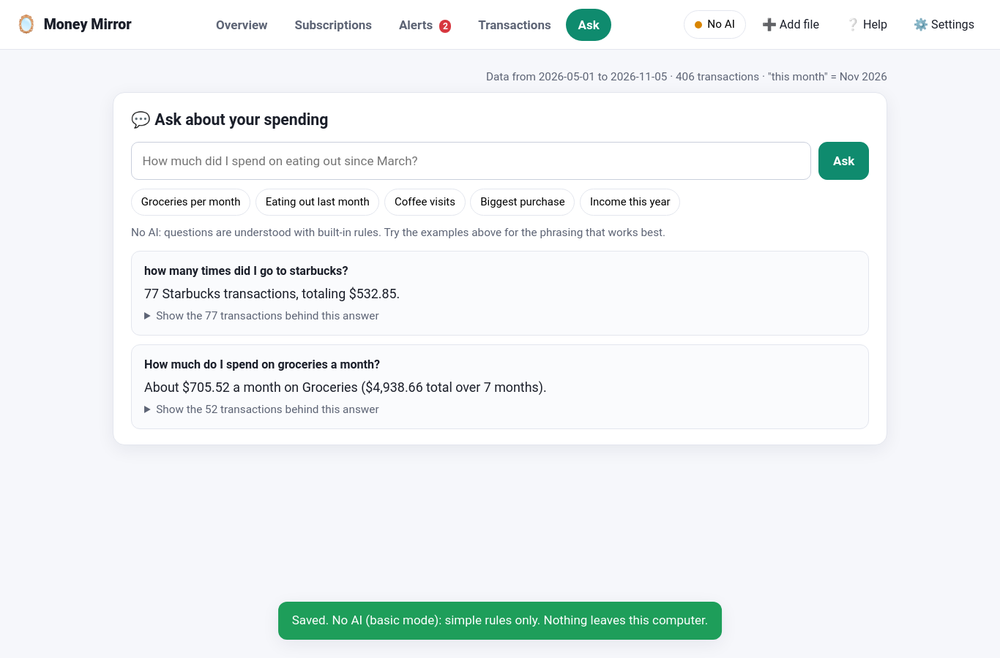

# User Guide

## Quick tour

1. Start the app: `python app.py`
2. Pick whether you want AI help (first time only — "No AI" is a fine choice).
3. Drop in your bank's CSV file, or click **Try it with example data**.
4. Look through the five tabs. Click anything to see the transactions behind it.

---

## Screen 1: Welcome (first time only)

Three big buttons:

- **💻 AI on my computer** — uses Ollama, a free program that runs AI on your own PC. The app checks whether it's installed.
- **☁️ Cloud AI key** — OpenAI or Gemini. You paste the key on the next screen.
- **🔒 No AI** — everything works with built-in rules. Good place to start.

AI is optional in Money Mirror. It only helps name unusual merchants and understand tricky questions. It never sees your amounts or dates. Change your choice any time in ⚙️ Settings.

---

## Screen 2: Add your bank file

- **The dotted box** — drag your CSV here or click to choose it. You can pick several files at once.
- **Try it with example data** — loads 7 months of made-up transactions (a checking account and a credit card) so you can explore.
- **Where do I find the CSV at my bank?** — click to open step-by-step hints.

After importing you see a short report: how many transactions were added, the date range, the first few rows as the app read them, and any places it couldn't categorize.

If the app had to guess which column is which, it tells you — check that the first rows look right (dates, places, and amounts in the right spots).

---

## Tab: Overview

**Four boxes at the top**
- **This month so far** — spending this month. Once you're at least 10 days in, it also shows the pace ("on pace for about $X").
- **Last month** — total spent and earned.
- **Typical month** — average spending over your full months (the current partial month is left out so it doesn't drag the average down).
- **Recurring bills & subs** — what your regular charges add up to per month and per year.

**Spending by month** — green bars are spending, the blue line is money in. Hover a bar for the exact number. Transfers between your own accounts and credit-card payments are left out so money isn't counted twice.

**Where it goes** — your biggest categories. **Click one** to see those transactions.

**Biggest changes** — compares your two most recent full months by category.

**Top places** — the merchants you spend the most at. **Click one** to see the charges.

**In plain words** — a short summary in everyday language.

---

## Tab: Subscriptions

Everything that charges you on a regular rhythm — monthly, weekly, every 2 weeks, quarterly, or yearly. The app finds them by spotting the same place charging a similar amount at regular intervals (at least 3 times, or twice a year apart).

Each row shows the amount, how often, the yearly cost, and tags:
- **up 16%** — the price increased. The row's small text shows the old price ("was $15.49").
- **stopped** — it hasn't charged you recently; probably cancelled.
- **varies** — a regular bill whose amount changes (utilities, phone).

Click a row to see every charge.

---

## Tab: Alerts

Things worth a second look, most important first:
- 🔴 **Possible double charge** — same place, same amount, within 3 days.
- 🟠 **Price increase** on a recurring charge, with the yearly impact.
- 🟠 **Fee** — overdraft, late, annual, foreign-transaction fees. Banks often reverse these if you ask.
- ⚪ **Recurring** — a reminder of each subscription ("still using it?").
- ⚪ **Big one** — a charge far bigger than usual for its category.

Click any alert to see the transactions.

---

## Tab: Transactions

Everything, newest first. Search by place, description, or category; filter by category or month.

**Changing a category:** use the dropdown on a row. The app updates every transaction from that place and **remembers it** for future imports. This is how you teach it.

**Export CSV** downloads everything with the cleaned merchant names and categories — handy for a spreadsheet.

---

## Tab: Ask

Type a question in plain English, or click an example chip. Things that work well:

- "How much did I spend on **groceries** **last month**?"
- "**How many times** did I go to **Starbucks**?"
- "**Average** eating out **per month**"
- "**Biggest** shopping purchase"
- "What did I spend at **Amazon** **since June**?"
- "How much did I **earn** **this year**?"

Every answer has a **Show the transactions behind this answer** link so you can check the math.

Without AI, the app understands these patterns with built-in rules. With AI on, it can handle more unusual wording — only your question text is sent, never your data. If a question isn't understood, the app says so instead of guessing.

Amounts are shown with "$" by default. If your bank uses another currency, change the symbol in ⚙️ Settings → Display (the app only changes the symbol; it doesn't convert).

---

## Settings

- **AI help** — the same choices as the welcome screen. Click **Test** after pasting a key.
- **Your data** — how many transactions you have and where they live (`~/.money_mirror/`). **Delete all transactions** keeps the categories you taught it; **Delete everything** removes those too.

---

## Tips

- **Add all your accounts** (checking + each credit card) for the full picture.
- **Export 12+ months** when you can. Subscriptions and price changes show up better with more history.
- **Re-import whenever you like.** The app recognizes rows it already has.
- **Teach it once.** Fixing one Transactions category covers that merchant forever.
